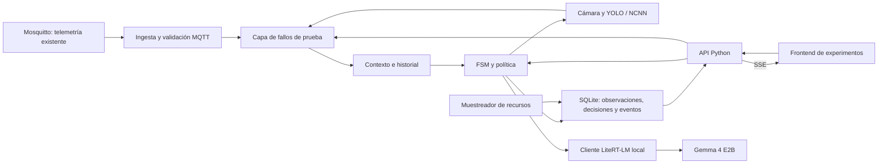
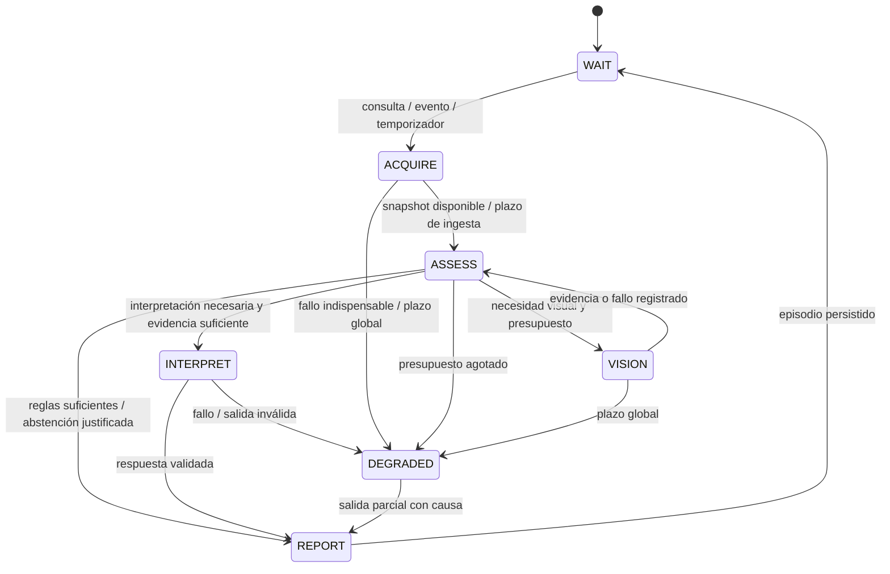

# 02. Arquitectura Python y FSM

## 1. Componentes con un dueño claro

Propuesta derivada de las tablas 3.1 y 3.2 del PDF; no depende de módulos Rust existentes.

Una aplicación Python con un proceso ASGI y un worker de cómputo, más el proceso LiteRT-LM ya operativo y Mosquitto existente, es suficiente. Los agentes son responsabilidades, no microservicios ni copias del modelo.

| Responsabilidad | Dueño | Qué no debe hacer |
|---|---|---|
| Recibir y normalizar lecturas | Adaptador MQTT | Llamar al SLM desde el callback. |
| Versionar observaciones y snapshots | Contexto/almacén | Inventar lecturas o tratar dato vencido como actual. |
| Elegir siguiente acción | Política determinista + FSM | Delegar guardas de validez a lenguaje libre. |
| Capturar y contar | Adaptador cámara/YOLO | Inferir identidad o interpretar riesgo ambiental. |
| Explicar evidencia | Intérprete SLM opcional | Controlar sensores, escribir código o ejecutar shell. |
| Guardar y emitir eventos | Registro + API | Depender de que exista un navegador conectado. |

FastAPI/Starlette es una opción práctica para validación HTTP y streaming; `Enum`, funciones y estructuras de datos bastan para la FSM. Paho MQTT tiene soporte de callbacks y bucle de red [S06]. No hace falta introducir LangGraph, CrewAI, AutoGen, Redis, Celery o un broker adicional para este prototipo.

## 2. Tres escalas de ejecución

- **Sesión experimental (`run_id`):** una configuración inmutable, un intervalo y sus condiciones de comparación. Puede contener muchos episodios.
- **Episodio (`episode_id`):** ciclo de la FSM disparado por consulta, temporizador o cambio relevante. Pertenece a una sesión.
- **Acción (`action_id`):** captura, inferencia, lectura del contexto o interpretación concreta.

Un chat manual crea una sesión corta y un episodio. El monitoreo crea una sesión larga con episodios sucesivos. La API usa el mismo motor para ambos; no ejecutar las métricas de tesis mediante un bucle dentro del frontend.

## 3. FSM propuesta

`WAIT`, `ACQUIRE`, `ASSESS`, `VISION`, `INTERPRET`, `DEGRADED`, `REPORT` son los estados funcionales del PDF. `queued/running/completed/cancelled/failed` son estados de la sesión o trabajo API, no clases del aula.

### Guardas y efectos

| Estado | Entrada | Decisión o efecto | Condición de salida |
|---|---|---|---|
| WAIT | Triggers y contexto | Agrupar cambios repetidos, conservar eventos significativos | Trabajo admitido con presupuesto. |
| ACQUIRE | Caché de MQTT e historial | Leer snapshot; opcionalmente esperar una publicación nueva hasta plazo corto | No esperar indefinidamente a todos los sensores. |
| ASSESS | Pregunta tipada y snapshot | Evaluar tiempo, región, calidad y necesidad | Responder, adquirir visión, interpretar o declarar desconocido. |
| VISION | Cámara/imagen y objetivo | Una captura; conteo o descripción explícita | Agregar observación y volver a evaluar una vez. |
| INTERPRET | Snapshot congelado | Gemma interpreta hechos y limitaciones | Validar estructura, referencias y coherencia básica. |
| DEGRADED | Error tipado | Preservar evidencia válida y marcar lo que no pudo hacerse | Una salida parcial/abstención; sin bucle de reintentos. |
| REPORT | Resultado final | Persistir antes de notificar éxito; cerrar episodio | WAIT o cierre de sesión. |

`ACQUIRE` no reimplementa drivers ni obliga a solicitar una lectura al hardware. Con los productores actuales significa reunir información ya publicada. Una orden real de refresco solo existiría si el productor MQTT implementa un contrato de petición/respuesta; no se asume.

## 4. Política adaptativa mínima

Propuesta de orden de evaluación, no algoritmo de utilidad entrenado:

El perfil fija objetivo de monitoreo, eventos relevantes, TTL y tipos de interpretación habilitados. No se activa el SLM por cualquier cambio: primero se evalúan calidad, magnitud/persistencia cuando correspondan y necesidad de información. Radar, ambiente, vencimientos y fallos pueden originar episodios. La matriz operacional y ejemplos están en [13 — guía de medición](13-guia-de-medicion.md).

1. Determinar pregunta y región. En el MVP, seleccionar tipo de pregunta por UI/API; lenguaje libre es entrada adicional opcional.
2. Rechazar acciones no autorizadas y consultas fuera del alcance espacial.
3. Comprobar si la evidencia necesaria es válida y suficientemente contemporánea.
4. Si una regla responde, producir resultado estructurado sin SLM.
5. Si falta conteo visual vigente y la cámara cubre la región, solicitar YOLO una vez.
6. Si la cámara no puede aportar la evidencia, declarar limitación; no invocar Gemma para inventar un dato.
7. Si se pide explicación y hay evidencia suficiente para una interpretación acotada, invocar Gemma con thinking siempre desactivado.
8. En cada rama registrar motivo de hacer o no hacer trabajo, costo observado y restricciones activas.

Motivos de ejemplo: `presence_answered_by_radar`, `count_missing`, `vision_stale`, `spatial_scope_mismatch`, `interpretation_requested`, `insufficient_evidence`, `cooldown_active`, `deadline_exceeded`. Son códigos de política propuestos, no diagnósticos físicos.

Una interpretación requerida puede ser una pregunta programada o un tipo de evento explícitamente habilitado en el perfil de monitoreo. Si el objetivo solo pide presencia/conteo, no es obligatorio generar explicación. En D se añade interpretación sobre la misma evidencia de C; dejar que el modelo cambie la adquisición sería otra variante.

Presencia positiva por sí sola no requiere YOLO. Si alguien pregunta por presencia visual fuera del radar, radar negativo no cierra la consulta. Un conflicto espacial aparente solo es conflicto real cuando las regiones y tiempos permiten compararlo.

## 5. Recursos y protección contra ciclos

Para iniciar el piloto: una acción pesada a la vez en la Pi, hasta una captura/ejecución visual y una interpretación por episodio; cero reintentos automáticos de inferencia generativa por defecto. Estos son límites iniciales, sujetos al piloto, no parámetros finales de tesis. El timeout de red no se elegirá menor que las latencias legítimas observadas.

Antes de una acción pesada comprobar memoria disponible, swap, carga y condición térmica. Definir umbrales con mediciones de la plataforma; no inventar una equivalencia entre CPU% y energía. Si una acción es necesaria pero no cabe en presupuesto, registrar `deferred` o `degraded`; no contar la pregunta como resuelta.

La llegada de una observación inválida y el paso del tiempo pueden cambiar el contexto incluso sin valores nuevos. Programar vencimientos; no depender exclusivamente de mensajes MQTT para detectar `stale`.

REPORT cierra el ciclo operativo, no necesariamente la necesidad contextual. Si requiere corroboración, guardar `followup_status`, `next_check_at`, fuente y condición de cierre. El temporizador/observación posterior abre un nuevo episodio con `followup_of_episode_id`; no mantiene bloqueado el worker. Limitar seguimientos y tiempo acumulado; al agotarlos, informar que no se pudo resolver. No volver a llamar a Gemma si las nuevas lecturas se resuelven por reglas.

Una cámara fallida durante `VISION` debe marcar el intento en el episodio antes de volver a `ASSESS`; de otro modo `count_missing` dispararía el mismo fallo indefinidamente. Reabrir un intento solo en otro episodio o tras un evento de recuperación, con cooldown registrado.

## 6. Concurrencia sin distorsionar mediciones

- La ingesta MQTT continúa mientras YOLO o Gemma trabajan. Un escritor lógico aplica cambios al contexto.
- La política evalúa un snapshot congelado. Las observaciones nuevas quedan para otro snapshot; no cambian silenciosamente el prompt a mitad de una llamada.
- Al terminar una inferencia lenta, la salida sigue referida al instante de la evidencia. Si ya venció, mostrar antigüedad al publicar; no afirmar que describe el presente.
- Mantener una cola de trabajo pesada acotada. Con cola llena, rechazar admisión explícitamente o agrupar triggers equivalentes; registrar lo agrupado.
- No agrupar entradas/salidas distintas como si fueran una sola lectura. Conservar historial de eventos relevantes aunque el estado actual se actualice por el último valor.
- Inicialmente, procesos persistentes para cámara/YOLO si se necesita cancelación fuerte; `to_thread` evita bloquear el event loop, pero cancelar la coroutine no detiene un cálculo nativo en curso [S08].
- Un solo worker ASGI evita duplicar suscripciones, FSM y modelos. Apagar `reload` durante mediciones [S09].

Una cancelación solicita que no se publiquen nuevos resultados. El slot de cómputo solo se libera cuando el backend confirma que el trabajo terminó, se canceló o el proceso fue detenido. Cerrar una conexión HTTP no prueba que LiteRT haya dejado de usar CPU.

### Controles experimentales y observación en vivo

La página puede pedir desactivación lógica, pérdida de mensajes o congelamiento de una fuente. La capa de fallos transforma únicamente lo visible para la política, con un orden de evento y una hora efectiva registrados. El productor MQTT y el hardware siguen separados; el fallo simulado no demuestra ahorro por apagar físicamente un dispositivo.

El contexto y cada resultado identifican la versión de disponibilidad de las fuentes. Si una fuente se desactiva mientras existe trabajo en curso, su resultado tardío no entra como nueva evidencia activa. Las observaciones históricas conservan su identidad y la política informa que ya no hay disponibilidad actual.

El muestreador de recursos es una tarea independiente de la FSM y del navegador. Sigue tomando muestras durante captura, inferencia y espera. Los eventos SSE permiten dibujar estado, decisiones, disponibilidad y gráficos sin alterar esas mediciones. Contratos concretos en [10 — controles y CSV](10-controles-y-csv.md).

## 7. Casos de aceptación de arquitectura

| Caso | Resultado exigible |
|---|---|
| Pregunta de presencia con radar vigente | Respuesta sin cámara ni SLM; evidencia referenciada. |
| Conteo faltante, cámara disponible | Una captura y conteo; ninguna explicación generativa obligatoria. |
| Cámara fallida | Salida parcial; no `count=0`; ninguna repetición infinita. |
| Inferencia visual de 30 s | MQTT sigue ingresando; salida conserva tiempo de captura. |
| Dos consultas simultáneas | Orden y espera explícitos; no dos modelos compitiendo sin registro. |
| Frontend cerrado | Monitoreo y persistencia continúan según la sesión. |
| Proceso reiniciado | Trabajos incompletos marcados como interrumpidos; no reejecutados silenciosamente. |

Fuentes técnicas: [S06, S08, S09, S10, S15 en el registro](09-fuentes.md). La estructura concreta y los límites son decisiones propuestas para SENSE.
